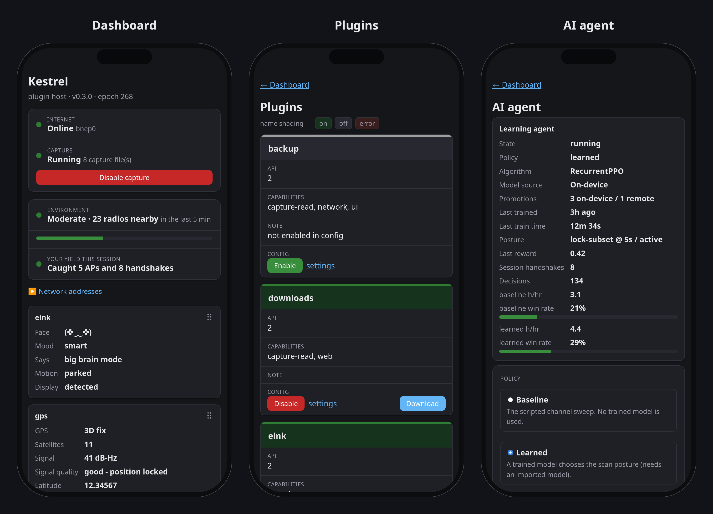
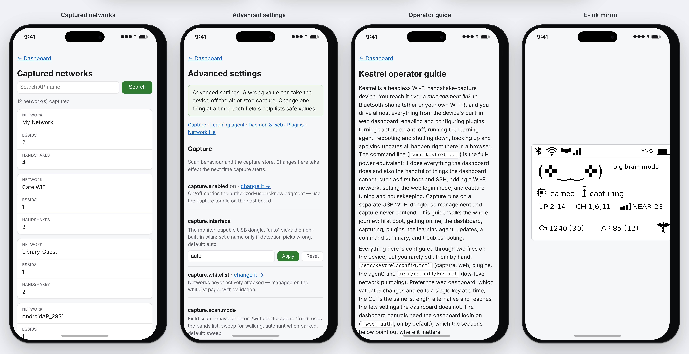
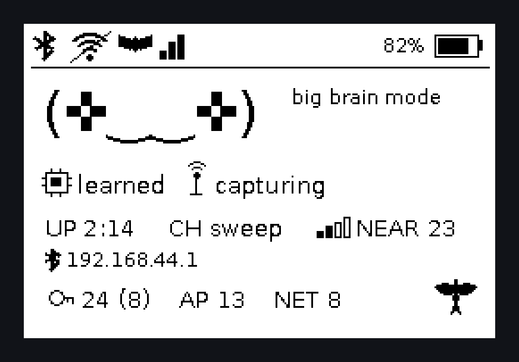

<p align="center">
  
</p>

# Kestrel

<p align="center">
  <a href="https://git.3ntropy.io/aluminum-ice/kestrel/releases"></a>
  <a href="https://git.3ntropy.io/aluminum-ice/kestrel/actions?workflow=lint.yml"></a>
</p>

A clean, secrets-free 64-bit Raspberry Pi OS image, built with [Packer](https://www.packer.io/) and [Ansible](https://www.ansible.com/), that turns a Raspberry Pi into a handheld Wi-Fi capture-and-learning device.

Kestrel is a small, battery-powered companion that sits nearby, listens to the Wi-Fi around it, collects WPA/WPA2 handshakes for offline analysis, and runs a reinforcement-learning agent that learns to choose where and how to listen: an autonomous, always-learning capture device built on a modern, maintainable foundation.

> **Authorized use only.** Kestrel is a research and education project. Use it only on networks you own or have explicit permission to test; capturing handshakes from, or deauthenticating, any other network may be illegal. See [Authorized use only](#authorized-use-only).
>
> The image also ships a documented DEFAULT login (`pi` / `raspberry`). Change it before any real use.

### Highlights

- **Modern, reproducible base.** A current 64-bit Raspberry Pi OS (bookworm, Python 3.11), produced by a scripted Packer + Ansible build rather than a hand-maintained card, so the whole image is easy to rebuild, audit and extend.
- **AngryOxide capture engine.** Capture runs on [AngryOxide](https://git.3ntropy.io/aluminum-ice/AngryOxide) over in-kernel `nl80211`/mac80211 drivers — no out-of-tree drivers or DKMS — on a dedicated USB adapter, so the built-in Wi-Fi and Bluetooth stay free for management.
- **Reworked plugin host.** A small daemon hosts features as plugins. The `Plugin` base class and `on_*` hook names follow the pwnagotchi plugin API (a ported plugin needs its hook signatures updated, since kestrel passes a typed event and context instead of pwnagotchi's `agent` object), with non-blocking off-loop dispatch, typed plugin context, capability and permission declarations, dependency ordering, hook-API versioning, and config validation with health reporting added on top.
- **Mobile-first web dashboard.** A responsive, dark-mode-aware dashboard and control surface — server-rendered and dependency-free — shows live status and per-plugin readouts and drives capture, plugins and power from a phone. (See [Web interface](#web-interface).)
- **Trainable learning agent.** An optional reinforcement-learning policy (stable-baselines3 / RecurrentPPO) picks the scan posture each decision window, with offline training, on-device fine-tuning, model import and remote training over SSH; it always falls back to a scripted sweep.
- **Consent-first and secrets-free.** Capture and any network-touching plugin ship disabled and require an explicit authorized-use acknowledgment before they run, and no credentials are baked into the image — so this repository is a safe, public base.
- **In-field updates.** Opt-in app-layer updates apply a new release in place over the network — no reflash — for the parts that can change safely.

The image is based on **Raspberry Pi OS Lite (64-bit), bookworm (Debian 12, Python 3.11), release 2026-06-18**, from Raspberry Pi's "oldstable" downloads. The Python stack (PyTorch and stable-baselines3) makes it large: the build uses an 8.4 GB root image, then shrinks it with PiShrink.

Target boards: the **Raspberry Pi 5** is the primary, standard board. The Raspberry Pi Zero 2 W is also supported as a smaller, lower-power option, within the constraints noted below (2.4 GHz-only Wi-Fi, and too little RAM to train the learning agent on-device). Both require an external USB WiFi adapter for packet capture (see WiFi capture adapter below).

## Authorized use only

Kestrel exists for research and education: learning how WPA/WPA2 handshakes, capture tooling and adaptive scanning work, on networks you are allowed to test.

- **Only capture networks you own, or have explicit permission to test** (in writing, ideally). Capturing handshakes from, or sending deauthentication frames to, any other network may be illegal where you are, even if you never try to crack what you captured.
- **You are responsible** for complying with the laws that apply to you, including radio and computer-misuse laws.
- **The safeguards are on by default.** Capture and every network-touching plugin ship disabled. Turning one on asks for an explicit authorized-use acknowledgment, which is never pre-ticked. The capture whitelist keeps the networks you list from ever being attacked.
- **Treat what the device collects as sensitive.** Handshakes, network names and locations can identify people and places. Keep them on the device or your own systems, and never publish them, including in issues and pull requests here: use placeholders such as `My Network` and `00:00:5E:00:53:01` instead.

Found a security problem in Kestrel itself? Please report it privately, as described in [SECURITY.md](SECURITY.md), rather than in a public issue.

## Web interface

The device serves a mobile-first web dashboard over its management link (Bluetooth PAN or Wi-Fi), over HTTPS with a sign-in page. It shows live status, how busy the RF environment is around you, per-plugin readout cards and the learning agent, and it drives capture, plugins and power — all server-rendered, dependency-free and dark-mode aware.

<p align="center">
  
</p>

Left to right: the **dashboard** (status, capture control, the Environment readout and plugin readout cards), the **plugins** page (enable/disable and per-plugin actions) and the **AI agent** page (policy, algorithm and live readout). The values are sample data. An interactive preview of these exact pages — live and scrollable — is at [`assets/branding/web-ui-iphone-preview.html`](assets/branding/web-ui-iphone-preview.html); open it in a browser.

<p align="center">
  
</p>

More of the interface: the **captured networks** page (searchable and paginated), the **advanced settings** editor (one validated key at a time), the on-device **operator guide**, and the **live e-ink mirror** — the exact frame the e-Paper HAT shows, viewable from your phone even with no HAT attached.

### The e-ink face

With the optional `eink` plugin and a Waveshare 2.7" e-Paper HAT, the device wears an animated "tamagotchi" face whose expression follows real device and learning-agent state — it never plays a canned loop.

<p align="center">
  
</p>

The panel shows a top icon strip (Bluetooth PAN and Wi-Fi link, a GPS satellite with signal bars, and battery), the mascot face with a mood-matched voice line, the **agent** mode (`off` / `baseline` / `learned`) and **capture** state, uptime, the channel plan and how many radios are in range (`NEAR`), the device's address on each connected link (so you can find the dashboard without your router's client list), lifetime and session counters for captured handshakes (`PWND`) and access points (`AP`), and the Kestrel mark in the corner. With no HAT attached it still renders to the web mirror.

## What's in the image

### Software

- **[AngryOxide](https://git.3ntropy.io/aluminum-ice/AngryOxide) v0.9.3** at `/usr/bin/angryoxide`, with bash completion. The statically linked `aarch64-musl` release build runs on every supported board. AngryOxide captures only on an external USB WiFi adapter, not the built-in chip (see WiFi capture adapter below).
- **No kernel headers or DKMS**: capture uses in-kernel drivers only, and Python packages install from prebuilt arm64 wheels, so the build compiles nothing. (Stock Raspberry Pi OS Lite itself ships `build-essential`.)
- **CLI utilities**: `git`, `screen` (the [screenrc](https://github.com/aluminum-ice/screenrc) config is temporarily not installed), `lnav`, `p7zip-full` (7z), `ncdu`, `lsof`, `rsync`, `sqlite3`, `unzip`, `cifs-utils`, `openvpn`, `fonts-firacode`.

The full apt package list is under `packages.general.install` in [`builder/config.yml`](builder/config.yml).

### WiFi capture adapter

Packet capture requires an external USB WiFi adapter on both boards. The built-in Wi-Fi chip can't do the monitor mode and injection AngryOxide needs, and AngryOxide is `nl80211`-based, so only in-kernel mac80211 drivers work. No out-of-tree drivers or DKMS are required, and Realtek 88XXAU is not supported.

| Chipset | Driver (in-kernel) | Bands | Active monitor | Example |
| --- | --- | --- | --- | --- |
| MediaTek MT7612U (reference) | `mt76x2u` | 2.4 + 5 GHz | Yes | ALFA AWUS036ACM |
| MediaTek MT7610U | `mt76x0u` | 2.4 + 5 GHz | Yes | ALFA AWUS036ACHM |
| MediaTek MT7921U | `mt7921u` | 2.4 + 5 GHz (WiFi 6E) | Limited | ALFA AWUS036AXM (needs kernel 5.19+) |
| Atheros AR9271 | `ath9k_htc` | 2.4 GHz | No | ALFA AWUS036NHA |
| Ralink RT5370 / RT5572 | `rt2800usb` | 2.4 GHz | No | Panda PAU09 |

MT7612U is the reference adapter: dual-band and active-monitor capable. The Pi 5 has spare USB ports for it; on the Zero 2 W the single USB OTG port holds the adapter (power is separate). The built-in Wi-Fi and Bluetooth stay free for management (SSH over Bluetooth PAN or Wi-Fi), so capture and management run on separate radios.

### Python

The image's Python 3.11 has `venv`. Bookworm blocks `pip install` into the system Python, so there is no system `pip`; the packages below install into a virtualenv at `/home/pi/.venv`, owned by `pi`. It sees system site-packages and activates automatically at login. PyTorch is pinned to `torch==2.10.0`, a release with a Python 3.11/arm64 wheel:

|                     |                   |                |                    |          |
| ---                 | ---               | ---            | ---                | ---      |
| `vcgencmd`          | `pyyaml`          | `tqdm`         | `requests`         | `urllib3` |
| `typing-extensions` | `python-dateutil` | `cryptography` | `rpi-hardware-pwm` | `numpy`  |
| `stable-baselines3` | `sb3-contrib`     | `gymnasium`    | `torch`            | `pytest` |
| `flask`             |                   |                |                    |          |

`stable-baselines3`, `sb3-contrib`, `gymnasium` and `torch` are the reinforcement-learning agent's runtime (`sb3-contrib` adds RecurrentPPO and QR-DQN; `gymnasium` is the agent's env interface); `flask` serves the plugin host's web status page. The `kestrel_pi` plugin-host package itself is also installed into this venv from its in-image source. The image carries only packages the project uses or is likely to use; add more to `pip.local.install` in [`builder/config.yml`](builder/config.yml) if you need them.

### System configuration

| Setting | Value |
| --- | --- |
| Hostname | `kestrel` (`MY_HOSTNAME` in the Makefile) |
| Timezone / locale / Wi-Fi country | `America/Los_Angeles` / `en_US.UTF-8` / `US` |
| Swap | 2 GB (`dphys-swapfile`) |
| SSH | Enabled (`raspi-config nonint do_ssh`). No host keys ship in the image: `ssh-host-keygen.service` creates them on first boot, so each device has its own |
| Wi-Fi | None baked in. Add your own networks under `system.network` (see below) |
| Interfaces | I2C, SPI and PCIe/NVMe (`pciex1_gen=3`) enabled. `gpu_mem=16`. Heartbeat activity LED. `i2c-dev` module loaded |
| Enabled services | `dphys-swapfile`, `fstrim.timer` |

### The `pi` user

- UID 1000. Member of `sudo`, `gpio`, `i2c`, `spi`, `dialout` and the other default groups.
- **Login:** documented default `pi` / `raspberry`. The password hash lives in `system.account.pi` in [`builder/config.yml`](builder/config.yml). Override it at build time with the `MY_PI_PASSWORD_HASH` environment variable, or edit the default. Generate a new hash with `openssl passwd -6` or `mkpasswd -m sha-512` (from the `whois` package).
- `~/.bashrc` activates `~/.venv`.
- An RSA-4096 SSH key pair is generated at `~/.ssh/id_rsa` on **first boot** by `pi-ssh-keygen.service`, so each device gets its own key.
- `~/github`, `~/Documents`, `~/Downloads` and an empty `~/deployments/` are created. `~/deployments/` is a copy of [`builder/extra/deployments/`](builder/extra/deployments), which ships empty: add your own files there to have them copied into the image.

### Adding Wi-Fi

No Wi-Fi is baked into this public image. To provision networks, set `system.network` in [`builder/config.yml`](builder/config.yml) to a mapping of `"SSID": "passphrase"` (highest priority last):

```yaml
network:
  "My Home Wi-Fi": "my-passphrase"
```

Each entry becomes a NetworkManager profile in `/etc/NetworkManager/system-connections/`. Keep real passphrases out of commits: supply them locally and do not push them to a public repo.

## Connecting to a headless device

With no Ethernet, reach the device over Bluetooth PAN (primary) or Wi-Fi. The built-in Wi-Fi/Bluetooth chip handles management; the USB capture dongle is never used for it.

**Bluetooth PAN (phone tethering).** On first boot the device opens a 10-minute pairing window (adjustable in `/etc/default/kestrel`) and advertises as `kestrel-XXXX`. Turn on your phone's Bluetooth tethering, then pair; pairing uses Just Works (no PIN), and the window closes on the first pairing. The device then connects to the phone's network, gets an address by DHCP (falling back to the standard iPhone/Android tethering addresses), reconnects on every boot, and is reachable at `ssh pi@<address>`. To onboard a different phone later: `sudo kestrel network bt-pair`.

**Wi-Fi station, at runtime.** Run `sudo kestrel network` for a menu that asks for the passphrase with the input hidden, or from a script `printf '%s\n' "$PSK" | sudo kestrel network wifi --ssid "My Network" --psk-stdin` (add `--hidden`, `--country GB` or `--band 5` as needed). Avoid `--psk "..."`: it lands in your shell history and the system journal.

**Wi-Fi band.** The built-in Wi-Fi joins on **2.4 GHz** by default: it works on every board (the Zero 2 W has no 5 GHz) and avoids mesh routers whose 5 GHz radios refuse the Pi. Choose per network with `band=` in the boot file or `--band` (`2.4`, `5` or `any`). To change the network already saved, without re-entering the passphrase: `sudo kestrel network wifi --band 5`. The default for newly saved networks is `WIFI_BAND` in `/etc/default/kestrel`.

**Wi-Fi station, from the boot partition.** Put the credentials in a plain text file named `kestrel-wifi.txt` on the boot partition (the FAT partition visible when the card is in a computer, `/boot/firmware` on the device):

```
ssid=My Network
psk=my passphrase
# hidden=yes
# country=GB
```

One `key=value` per line:

| Key | Required | Value |
| --- | --- | --- |
| `ssid` | yes | Network name, exactly as broadcast. |
| `psk` | no | Passphrase, 8-63 characters (or 64 hex digits). Leave it empty or omit the line for an open network. |
| `hidden` | no | `yes` for a network that doesn't broadcast its name; default `no`. |
| `country` | no | Two-letter Wi-Fi regulatory country code, e.g. `US`, `GB`, `DE`. |
| `band` | no | `2.4`, `5` or `any`; default `2.4` (see Wi-Fi band above). |

Format rules:

- No spaces around `=`, and no quotes: everything after the first `=` is the value, taken literally (spaces, `#` and `=` included). `ssid = Home` or `ssid="Home"` won't match your network.
- Blank lines and lines starting with `#` are ignored. Windows (CRLF) line endings are fine.
- Unknown keys are ignored with a note in the log.

The file is read on the next boot where it is present, not only the first, and is **deleted right after it is read**, even if an entry is invalid, so the passphrase doesn't stay on the card. It saves one network: dropping in a new file later replaces the previous one. If it didn't work, check `journalctl -u kestrel-wifi-provision` over Bluetooth. Raspberry Pi Imager's own Wi-Fi customization also works.

`kestrel setup` (also `pwn-config`) is the guided entry point; `kestrel network status` shows both links.

## WiFi capture (opt-in)

Packet capture with [AngryOxide](https://git.3ntropy.io/aluminum-ice/AngryOxide) is **off by default** and runs only on the external USB dongle, so management (Bluetooth PAN / Wi-Fi) is never disturbed. It transmits deauthentication frames: use it only on networks you own or are explicitly authorized to test. See [`docs/developer/capture-interface.md`](docs/developer/capture-interface.md) for the interface the agent and plugins build on.

Enable it after an authorized-use acknowledgment. The acknowledgment is asked
once and then remembered; `capture reset-ack` makes it ask again:

```bash
sudo kestrel capture enable            # auto-detects the dongle, prompts once, starts now
sudo kestrel capture enable --interface wlan1 --yes   # non-interactive
kestrel capture status                 # state, adapter, store, ack state
sudo kestrel capture disable
sudo kestrel capture reset-ack         # forget the acknowledgment (re-ask next enable)
```

By default capture does a **scripted channel sweep**: it rotates through every channel the adapter supports, dwelling `dwell_seconds` on each while it discovers APs and captures WPA handshakes/PMKIDs, then rotates again. That makes the device useful in the field on its own, with or without the learning agent. Everything is configured in [`/etc/kestrel/config.toml`](builder/extra/files/config.toml): the scan mode (`sweep`/`autohunt`/`fixed`) and dwell, a `whitelist` of SSIDs/MACs never to attack, and the output layout.

**Whitelist from the boot partition.** Like Wi-Fi credentials, the whitelist can be staged before first boot: put a plain text file named `kestrel-whitelist.txt` on the boot partition (`/boot/firmware` on the device), one SSID or MAC per line (`#` comments and blank lines ignored). On boot the entries are merged into `[capture] whitelist` and the file is removed, so you can prepare a card for the field without SSHing in. `config.toml` stays the lasting source of truth afterward.

Captures land in `/var/lib/kestrel/capture/` — one `.hc22000` file per SSID by default, or one combined file (`[capture.output] mode`). The store is **append-only**: handshakes accumulate across reboots and restarts and are never overwritten. Manage its size with `kestrel capture archive` (move captures aside, start fresh), `capture clear --yes` (delete), or the opt-in `[capture.housekeeping]` policy; the store itself is never deleted automatically. What *is* bounded automatically is AngryOxide's raw working dir (`/var/lib/kestrel/capture-run/`): its `.pcapng` and kismet DB grow for the whole session and would otherwise fill the card, so `[capture.housekeeping] max_run_mb` (default 512) rolls the capture when that dir gets too big, deleting the raw files while keeping every extracted hashline. Set it to `0` to keep full packet captures.

## Plugins

Features ship as plugins hosted by a small daemon, `kestrel-daemon.service`. The daemon is installed and **enabled**, but benign on its own: with no plugins enabled it just runs an event loop and serves a read-only web status page over the management link. Nothing it does touches captures or the network until a plugin is explicitly enabled. It sources `on_handshake` from the capture store and `on_internet_available` from the management link (either BT PAN or Wi-Fi), dispatches hooks off its loop so one slow plugin can't stall the others, and also hosts the learning agent and the device UI. See [`docs/user-guide/user-guides.md`](docs/user-guide/user-guides.md) for step-by-step setup guides.

Fourteen reference plugins ship, **all disabled**: `memtemp` (display stub), `session-stats` (timer + web view), `gps` (position source: tags handshakes and shares the fix), `wpa-sec` (upload hashlines, opt-in), `wigle` (wardriving upload, opt-in; uses `gps` when enabled but doesn't require it — uploads only ever carry a real fix, and without `gps` it runs idle or in geolocate-only display mode; see [`docs/user-guide/wigle-setup.md`](docs/user-guide/wigle-setup.md)), `backup` (opt-in off-device backup of the capture data and the trained learning-agent model to a remote host over rsync/SSH; see [`docs/user-guide/backup-setup.md`](docs/user-guide/backup-setup.md)), `ups-hat` (Waveshare UPS HAT battery readout, with an optional low-battery auto-shutdown; it confirms the HAT is on the I2C bus before doing anything; see [`docs/user-guide/ups-hat-setup.md`](docs/user-guide/ups-hat-setup.md)), `eink` (an animated "tamagotchi" face on the Waveshare 2.7" e-Paper HAT that reflects live device and learning-agent state, with a roaming/parked indicator and a live web mirror of the panel; see [`docs/user-guide/eink-setup.md`](docs/user-guide/eink-setup.md)), `updates` (alerts on a newer release and applies an app-layer update in place; see [`docs/user-guide/updates.md`](docs/user-guide/updates.md)), `remote-train` (offloads learning-agent training to a desktop host over SSH; see [`docs/user-guide/remote-training.md`](docs/user-guide/remote-training.md)), `downloads` (download your handshake files from the dashboard as a zip or one combined `.hc22000`, only over the encrypted dashboard; see [`docs/user-guide/downloads.md`](docs/user-guide/downloads.md)), `map` (every located captured network on one map over an OpenStreetMap background, with a configurable tile server or none; see [`docs/user-guide/map.md`](docs/user-guide/map.md)), `notify` (short alerts to ntfy or Telegram for new handshakes, a low battery, an update or capture stopping, counts only by default; see [`docs/user-guide/notifications.md`](docs/user-guide/notifications.md)), and `hat-buttons` (the e-Paper HAT's four keys: an info screen, stop capture, and reboot or shut down after a second press; see [`docs/user-guide/hat-buttons.md`](docs/user-guide/hat-buttons.md)). The uploaders, the backup, `updates`, `remote-train` and `notify` transmit data off the device, so enabling one takes the same authorized-use acknowledgment as capture and collects the operator's own settings (nothing is baked in); `ups-hat`, `eink` and `hat-buttons` read and drive only local hardware, so they need no acknowledgment.

Manage plugins with the `kestrel plugins` tool rather than editing `config.toml` by hand:

```bash
kestrel plugins list                   # every plugin and whether it's enabled
kestrel plugins info gps               # capabilities, options, deps, live health
sudo kestrel plugins enable session-stats
sudo kestrel plugins enable wpa-sec    # uploader: asks for the key (input hidden)
sudo kestrel plugins disable wpa-sec
```

Running `enable` in a terminal walks you through the plugin's declared options — secrets masked, scalars pre-filled with the current/default (press Enter to keep), and yes/no for toggles like wpa-sec's `download_results` — so everything can be set at enable time. `--set key=value` sets any option non-interactively (handy for scripting). For a secret use `--set-stdin KEY` and pass the value on stdin instead: anything on the command line lands in your shell history and in the system journal (sudo logs every command line), and the CLI warns if a secret is given with `--set`.

Operator-added plugins drop a `.py` into `/etc/kestrel/plugins/` (which overrides a shipped plugin of the same name) and get a `[plugins.<name>]` table in `config.toml`. The web status page (and each web plugin's routes under `/plugins/<name>/…`) is served on the management interfaces and loopback only — `[web] bind = "management"`, default port 8080 — never on the capture dongle.

## Using a release

1. Download `kestrel-<version>.7z` and `kestrel-<version>.7z.sha256` from the repository's Releases page.
2. Verify the download: `sha256sum -c kestrel-<version>.7z.sha256`.
3. Extract with `7z x kestrel-<version>.7z`, then verify the image: `sha256sum -c kestrel-<version>.sha256`.
4. Flash `kestrel-<version>.img` with Raspberry Pi Imager (choose "Use custom") or `dd`.

## Building

### With Forgejo Actions (recommended)

Run the **Release** workflow (Actions, then Release, then *Run workflow*). It runs on a self-hosted Forgejo runner with the `image-builder` label; see [Cutting a release](docs/developer/releasing.md) for that host's requirements.

| Input | Purpose |
| --- | --- |
| `release_version` | Version written to `_version.py`: `X.Y.Z`, or `X.Y.Z-beta.N` for a beta (published as a pre-release). Also the release tag and part of the asset names. |
| `update_kind` | `auto` (default), `app-layer` or `reflash`: whether devices can take the release in place. |

The workflow builds the image and publishes a Forgejo release tagged at the built commit, with `kestrel-<version>.7z` and `kestrel-<version>.7z.sha256` attached. The image's own `.sha256` is inside the archive.

### Locally

Requirements: an x86_64 or arm64 Linux host with `sudo`, `make`, `curl`, `unzip`, `git`, Go (tested with 1.24), `qemu-user-static`, `7z` (`p7zip-full`), `parted` and `e2fsprogs` (for PiShrink), and roughly 15 GB of free disk.

```bash
make plugin                       # build the Packer arm-image plugin (as your user)
sudo make image                   # version taken from _version.py
MY_VERSION=1.2.3 sudo make image  # override the version
make clean                        # remove build outputs, the downloaded Packer and PiShrink, and the plugin
```

`make image` downloads Packer 1.9.5 and PiShrink v26.03.16 (pinned commit, SHA-256 verified) to `/tmp/raspberrypi/` and uses the `solo-io/arm-image` plugin that `make plugin` builds from a pinned v0.2.8 commit into `/tmp/raspberrypi/plugins/`. (The newest published plugin release, v0.2.7, has a race that can fail the build with "error different of partitions than expected"; v0.2.8 fixes it but has no release binaries.) It then runs [`builder/config.json`](builder/config.json), which boots the base image under QEMU and runs the [`builder/config.yml`](builder/config.yml) playbook inside it. Outputs land in the repository root as `kestrel-<version>.img`, `.sha256`, `.7z` and `.7z.sha256`.

## Customizing

Almost everything is driven by the `vars:` block at the top of [`builder/config.yml`](builder/config.yml):

| Variable | Controls |
| --- | --- |
| `system.*` | Boot options, kernel modules, swap, locale/timezone, SSH, pip version, `pi` password, Wi-Fi networks |
| `packages.general.install` | apt packages |
| `packages.angryoxide` | AngryOxide release tag, asset name and SHA-256 checksum |
| `pip.bootstrap.install` / `pip.local.install` | pip/setuptools/wheel, then the Python packages in `/home/pi/.venv` |
| `services.enable` | systemd units to enable |

- To change the base image, update `iso_url` **and** `iso_checksum` in [`builder/config.json`](builder/config.json).
- To ship extra files to the Pi, add them under `builder/extra/deployments/`.
- The playbook runs with the Ansible version from the bookworm repositories (ansible-core 2.14), so avoid newer modules and options.

## Linting

`make lint` runs quick static checks without building the image:

- `ansible-playbook --syntax-check` on the playbook
- `yamllint` on all YAML files
- `shellcheck` on all shell scripts

```bash
pip install -r requirements-lint.txt
make lint
```

The same checks run in the **Lint** Forgejo Actions workflow on every push and pull request, and `make test` runs in the **Test** workflow.

## Repository layout

```
.
├── Makefile                  # build and lint entry points
├── _version.py               # image version
├── LICENSE                   # GPL-3.0-or-later
├── requirements-lint.txt     # tools for `make lint`
├── assets/
│   └── branding/             # logo, favicon, brand sheet, web-UI preview
├── docs/                     # documentation, split by audience
│   ├── user-guide/           # operating a built device
│   ├── developer/            # building/extending kestrel
│   └── images/               # screenshots for the README and docs
├── builder/
│   ├── config.json           # Packer template (base image, provisioners)
│   ├── config.yml            # Ansible playbook (all customization)
│   └── extra/
│       ├── files/            # scripts, config tool, systemd units, plugins
│       │   ├── plugins/      # shipped plugins (all disabled)
│       │   ├── kestrel_pi/   # plugin-host daemon + learning-agent package + tests
│       │   ├── systemd/      # kestrel systemd units
│       │   └── scripts/      # operator helper scripts (installed read-only)
│       └── deployments/      # empty; add files to copy into the image
├── .forgejo/
│   ├── workflows/            # Release, Lint and Test CI (Forgejo Actions)
│   └── gen-release-notes.py  # release-notes helper
├── CLAUDE.md                 # guidance for Claude Code
└── .claude/                  # Claude Code project settings and session hook
```

## License

Kestrel is released under the [GNU General Public License v3.0 or later](LICENSE).
